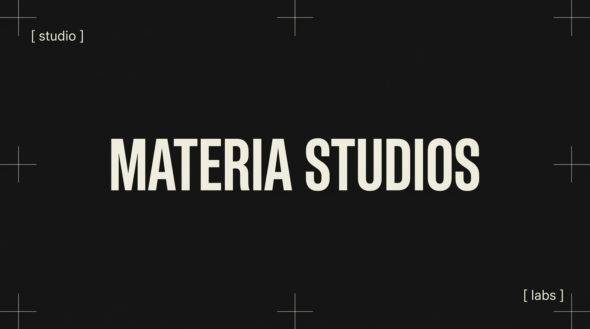

  

   
   

  

    <strong>ITALIA / SVIZZERA / RSM</strong>
  

  

    We are a group of minds that uses technological, strategic, and creative skills in an organized way to build effective solutions for achieving complex goals.
  

  

    <a href="https://materiastudios.it/"><strong>Website</strong></a> ·
    <a href="https://www.linkedin.com/company/materia-studios-it"><strong>LinkedIn</strong></a> ·
    <a href="https://www.instagram.com/materia__studios"><strong>Instagram</strong></a> ·
    <a href="mailto:info@materiastudios.it"><strong>Contact</strong></a>
  

---

### `[ studio ]` — Strategy, Design & Engineering
We partner with brands and organizations to architect digital products, visual systems, and high-impact technological infrastructures. From art direction and motion design to full-stack engineering, every deliverable is built for precision and scalability.

### `[ labs ]` — Research, Tooling & Open Source
Our internal R&D playground. Here we experiment with emerging technologies, design systems, custom typography tools, creative coding, and internal utilities that power our daily workflow.

---

### Core Focus

| Area | Capabilities |
| :--- | :--- |
| **Engineering** | Web Architectures, Full-Stack Development, Creative Coding, Internal Tooling |
| **Design** | Digital Product Design, Design Systems, Art Direction, Motion & 3D |
| **Strategy** | Brand Positioning, Digital Transformation, Technical Consulting |

---

  
    Held by <strong>Jam Group Srl</strong> · San Marino (RSM) · <a href="mailto:info@materiastudios.it">info@materiastudios.it</a>
  

